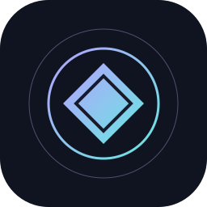
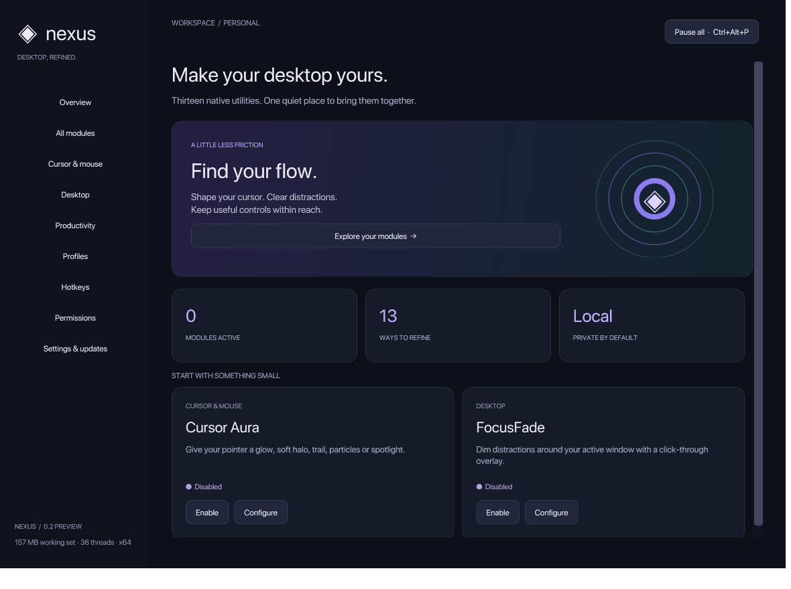

<p align="center"></p>

# Nexus

[GitHub monorepo](https://github.com/qemvix/nexus) · [Builds](https://github.com/qemvix/nexus/actions)

**Windows desktop utilities.** A native Windows utility ecosystem with one hub, one installer and thirteen independently controlled features. Built with C# / .NET 10 and WPF; no web view, cloud account or subscription dependency.

**0.2.2:** useful native implementations for every module, with limits listed below. This is an unsigned preview, not a claim that every advanced behavior in the original product brief is production complete. Windows x64 only. Windows 11 is the primary test platform; Windows 10 and mixed-DPI hardware need broader validation.



## Install or run

Download `Nexus-Setup.exe` from the [official public release](https://github.com/qemvix/nexus/releases/tag/desktop-v0.2.2), or use the locally supplied installer. Open it and choose **Install Nexus**. It installs for the current account in `%LOCALAPPDATA%\Programs\Nexus`, creates a Start-menu shortcut, and registers with Windows Installed Apps. No administrator elevation or automatic startup entry is requested.

For portable use, extract `Nexus-0.2.2-win-x64-portable.zip` and open `Nexus.exe`. Both distributions are self-contained: the end user does not need to install .NET. The 26 KB CursorBlur engine is embedded as a verified native resource. Build the complete Nexus release with the command below.

All features start disabled. Open **Permissions**, grant the capabilities you intend to use, then enable a feature from the library. Closing the hub keeps Nexus in the notification area. **Ctrl+Alt+N** reopens it; **Ctrl+Alt+P** stops all modules. Use the tray's **Exit Nexus** to release all hooks and overlays.

Unsigned builds may show Windows publisher/SmartScreen warnings. Review the source and compare the supplied SHA-256 hashes. Public distribution should use the publisher's Authenticode certificate; hashes alone do not establish publisher identity.

## What works in this preview

| Package | Utility | Native behavior | Current limits |
|---|---|---|---|
| `nexus-cursor` | Cursor Aura | Glow, soft halo, trails, particles and cursor spotlight | Blur is a soft halo, not motion blur applied to the OS cursor; no separate click pulse in Aura (use ClickFX) |
| | ClickFX | Left/right click colors, ripples, rings, shockwaves, duration/radius and optional system sound | Right color is fixed cyan; arbitrary sound files and independent animation timelines are not yet exposed |
| | ScrollFlow | Your Glide engine: finite eased pulses, native touchpad gestures, vertical/horizontal wheel fallback, exclusions, fullscreen pause and per-app tuning | Run instead of standalone Glide; native gestures need OS support; fallback wheel packets may be coalesced |
| | Cursor Lens | Real screen magnification, zoom, circle/square shape, presentation crosshair; shared 60–240 FPS target and reused capture surfaces | Protected content excluded; actual capture FPS depends on hardware/load; no optical focus filter or HDR processing |
| | CursorBlur | Original supplied CursorBlur.exe, bundled and managed in a kill-on-close Windows job | No Configure screen; native timing and motion are independent of WPF settings; Microsoft Visual C++ v14 x64 runtime required |
| `nexus-desktop` | Float | Live CPU/RAM/clock/OS/core information, media keys, optional coordinate-based weather | Weather is fetched once on enable; no now-playing title, widget designer or weather auto-refresh |
| | WindowGlide | Half/quarter/third/custom normalized zones, global shortcuts, eased movement and magnetic edge snap | Custom zones use JSON; top-level captioned windows only; no drag preview or layout designer |
| | ClipVault | Bounded text and RTF history, search, pin, plain-text cleanup, copy, delete/clear, shortcut | Memory only, at most 100 entries; pins do not survive disable/exit; no image/file history |
| | FocusFade | Click-through dimming outside the active window and accent outline | No app exclusions, automatic hiding/minimizing, or animated focus transitions yet |
| `nexus-productivity` | ScreenRuler | Crosshair, ruler ticks, physical-pixel coordinates, anchored rectangle measurements, screen color to clipboard | Ruler labels are monitor-local; mixed-DPI/rotated screens need testing; colors are SDR capture values |
| | KeyCast | Ephemeral shortcut/key/mouse-button overlay with color, size and duration | Keyboard permission required; all-keys mode can expose passwords on screen; no automatic password-field detection |
| | Glassify | Foreground/per-process opacity and topmost settings; original state restored on normal shutdown | No arbitrary third-party blur; changes can fail on elevated/protected windows; forced termination cannot guarantee restoration |
| | QuickDock | Media/volume keys and direct access to Windows sound, brightness/display, Wi-Fi, Bluetooth and power controls | Device controls open native Windows settings; no embedded Wi-Fi scan or hardware brightness slider |

Each feature can be installed, enabled, disabled and uninstalled in the hub. **Feature install/uninstall is logical:** it adds/removes that feature's settings and resources; the family's shared assembly remains in the one executable. Independently downloaded binaries and third-party plugin installation are roadmap work.

## Shared platform

- Deterministic module registry, API version check, cleanup on partial start failure and isolated module error states.
- Shared, ref-counted input hooks; no keyboard hook unless KeyCast is enabled. ScrollFlow owns Glide's dedicated input thread and tagged output rather than sharing the former Nexus smoothing timer.
- One composition-synchronized clock for Nexus-rendered overlays with a 60–240 FPS target, per-overlay measured rendering rates, and no remaining low-rate overlay/capture timers.
- Global hotkey registration with collision reporting and a fixed emergency pause.
- Versioned, typed settings with validation, atomic writes and backup recovery.
- Named profiles, JSON import/export and local settings storage. Profile transfer is manual; cloud/live settings sync is not implemented.
- Minimal dark theme, keyboard navigation, named inputs, scalable WPF controls and reduced-motion support. Light mode and comprehensive high-contrast/screen-reader auditing remain open.
- Local bounded diagnostics and process memory/thread information. No telemetry upload or crash dump collection.
- Opt-in RSA-PSS/SHA-256 signed-update verification and binary hashing. Optional daily checks require network permission, the included publisher URL/key and an explicit toggle. An available update appears in Settings & updates; download/install remain user initiated and preserve settings.
- Per-user installer/uninstaller in the same executable, portable packaging and Windows build/release CI.

## Build from source

Install the .NET 10 SDK on Windows. No third-party application runtime libraries or NuGet test framework are required.

```powershell
dotnet build Nexus.sln -c Release -warnaserror
dotnet run --project tests/Nexus.Tests -c Release
dotnet run --project tests/Nexus.Tests -c Release -- --integration
dotnet run --project apps/desktop
```

Complete verification and packaging (PowerShell):

```powershell
./scripts/build.ps1 -Publish -Integration
dotnet format Nexus.sln --verify-no-changes --no-restore
```

Artifacts appear in `artifacts/release/`: `Nexus-Setup.exe`, `Nexus.exe`, the portable ZIP and `SHA256SUMS.txt`. Use the setup-named file or pass `--install` to the published executable. `--install` requires the published single-file executable; copying a development apphost alone is not a valid installation.

The dependency-free test runner intentionally uses `dotnet run`, not `dotnet test`. It returns nonzero on failed assertions. Native integration tests briefly create overlays and floating windows, exercise hooks/listeners and confirm cleanup; run them on a Windows desktop. They do not prove compatibility with every target application or monitor configuration.

## Repository

```text
nexus/
  apps/desktop/                   Nexus.exe, hub, tray, installer
  packages/cursor-mouse/           nexus-cursor
  packages/desktop-customization/  nexus-desktop
  packages/productivity/           nexus-productivity
  packages/core/                   nexus-core
  tests/Nexus.Tests/               unit and native lifecycle tests
  scripts/                        build and signed release tools
  docs/                           plan, architecture, features, release guides
  .github/workflows/ci.yml         Windows checks and draft tagged releases
```

## Documentation

- [Implementation plan](docs/IMPLEMENTATION_PLAN.md)
- [Architecture and module API](docs/ARCHITECTURE.md)
- [Feature guides](docs/features/README.md)
- [Glide source integration](docs/GLIDE_INTEGRATION.md) and [CursorBlur / overlay rendering](docs/CURSORBLUR_INTEGRATION.md)
- [Installation and removal](docs/INSTALLATION.md)
- [Privacy and permissions](docs/PRIVACY.md)
- [Test strategy and validation](docs/TESTING.md)
- [Release guide](docs/RELEASING.md), [release notes](docs/RELEASE_NOTES.md), [roadmap](docs/ROADMAP.md)
- [Contribution guide](CONTRIBUTING.md), [landing-page copy](docs/LANDING_PAGE_COPY.md)

Proprietary; copyright (c) 2026 qemvix, all rights reserved. Official Nexus releases may be used for personal desktop use under [LICENSE](LICENSE). Other uses require the permission described there. Third-party components retain their own terms and attribution. The app runs independently of ChatGPT or a Plus subscription.
