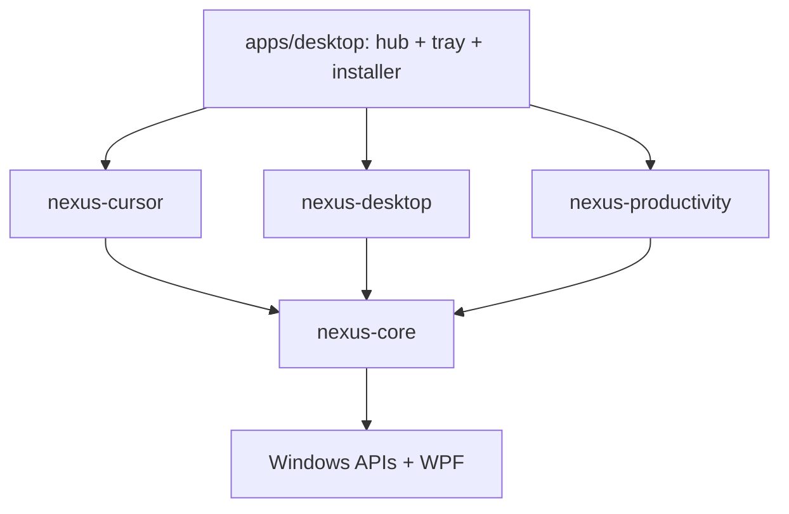

# Architecture

Nexus is a Windows desktop process with a WPF application, tray icon and trusted compiled module families. It is not a browser wrapper. C# compiler nullable analysis, analyzers and `-warnaserror` enforce type/build checks; `dotnet format` enforces source formatting.

## Dependency direction



`Manifest` identifies a stable feature id, name, category, requested capabilities, API version and module version. `INexusModule` exposes the manifest, option schema, Start/Stop/Dispose and an optional editor panel. `NexusModule` manages reverse-order disposal and cleans up a partially failed startup. `ModuleManager` tracks Available, Disabled, Running, Blocked and Faulted states and persists user intent.

## Extending the trusted catalog

Subclass `NexusModule`, declare capabilities and register the instance in a family catalog. Example:

```csharp
public sealed class Example() : NexusModule(
    new("example", "Example", "Productivity", "An example utility", Capability.Mouse))
{
    protected override void OnStart()
    {
        Resources.Add(Context.Input.Mouse(e => { /* Tiny, nonblocking callback. */ }));
    }
}
```

An incompatible API version or duplicate id is rejected. Modules may use only capabilities they declare; platform review and code review enforce this for trusted code. The app's grant flags are **not an isolation boundary**. The current release does not discover/load arbitrary DLLs, download plugins or sandbox third-party code. A broker process with narrow IPC is needed before such a marketplace is safe.

## State and profiles

The schema version is 1. Settings live in `%LOCALAPPDATA%\Nexus\settings.json`. A temporary file and Windows atomic replacement produce a `.bak` recovery copy. Values are bounded, invalid nested state is rejected, and unsupported schema versions are rejected by validation. The store preserves a rejected-source copy when disk access permits, then attempts backup/default recovery with a visible message. Read and import size limits bound memory exposure. Automatic cross-version schema migration is future work.

`ModuleOptions` is a typed shared transport with schema-selected fields, validated again against each feature's controls. `ScrollProfile` holds process name, speed, inversion and optional glide duration; old momentum values remain for JSON compatibility. `WindowZone` uses normalized coordinates. Custom editors accept typed JSON, not executable code. Profiles deep-copy module settings, excluding grants and private clipboard data. Unknown ids are not executed.

## Windows services and lifecycle

`InputService` owns shared mouse/keyboard hooks for effects and KeyCast. ScrollFlow separately hosts Glide's dedicated input/message thread, observer, synthetic touchpad output and tagged wheel fallback. Its former WPF timer is removed. Process queries stay outside Glide's callback, and precision/modifier input bypasses it. See GLIDE_INTEGRATION.md. Keyboard values are not saved.

`HotkeyManager` uses a message-only HWND and RegisterHotKey with no-repeat. Every registration returns an idempotent disposable. System/other-app conflicts are surfaced. The emergency pause and hub shortcuts are fixed; module toggle shortcuts are editable. Module action shortcuts are fixed in 0.1.

`Overlay` creates non-activating, click-through windows per monitor. One composition event drives all overlays with a 60–240 FPS target and fractional frame credit; actual drawing callback rates are measured. Physical coordinates convert to local DIPs. Display changes rebuild windows and capture exclusion avoids feedback where supported. Cursor Lens reuses opaque BGR capture/image surfaces. CPU/GPU cost scales with monitor area and enabled effects.

Normal exit/disabling releases hooks, timers and windows. Glassify remembers original extended style, layered alpha and topmost state and restores matching process/window handles. Forced termination, application crashes and third-party style changes may prevent perfect restoration. WindowGlide intentionally leaves user-requested window positions in place.

## Distribution and updates

The published self-contained single-file app doubles as the installer when named `Nexus-Setup.exe` or passed `--install`. Installation stages one known executable, creates a per-user Start-menu shortcut and registers Installed Apps metadata. Uninstall runs a temporary helper so it can remove the installed executable without deleting an arbitrary path; settings remain outside the install directory.

The update envelope contains `Payload` and `Signature`. The exact UTF-8 payload is signed with RSA-PSS/SHA-256 and includes Version, HTTPS Url and binary Sha256. The client rejects tampered manifests and hash-mismatched downloads. Publisher URL/key provisioning and Authenticode signing are separate release tasks. An opt-in daily check is off by default and requires network permission; download and installation always require a user action. Network revocation cancels in-flight update requests.
